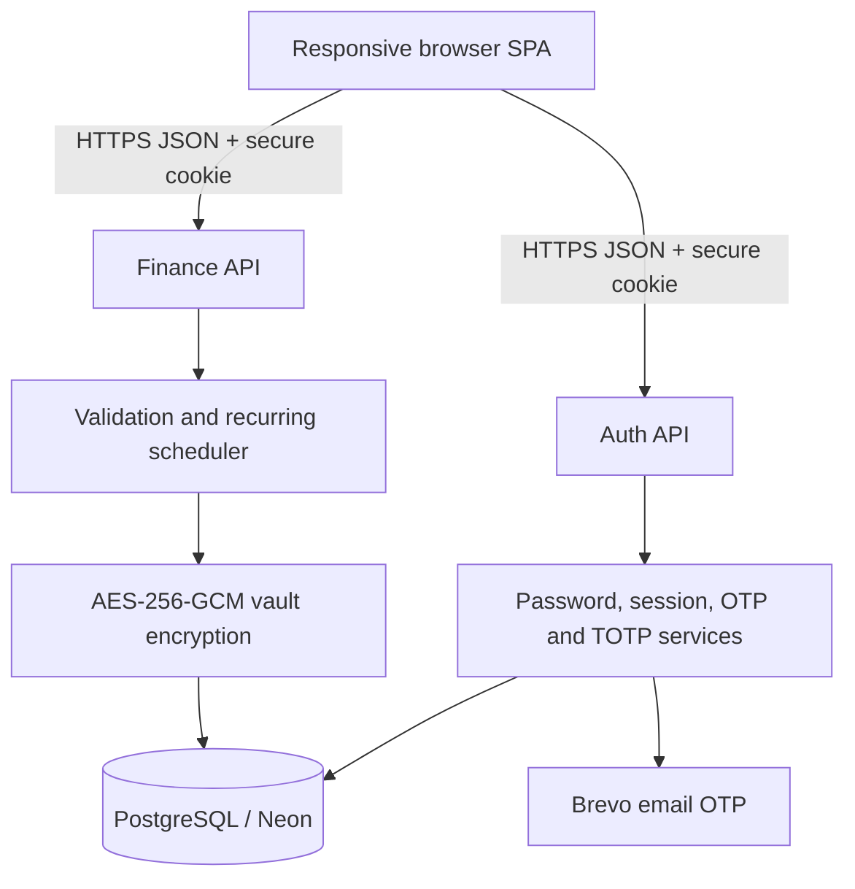

# Paisa architecture

Paisa is a full-stack, multi-user personal-finance application deployed as a static single-page frontend plus Vercel serverless API functions. PostgreSQL/Neon provides persistent storage.

## Frontend

`public/index.html` is a dependency-light responsive SPA using HTML, CSS and browser JavaScript. It owns presentation and interaction only; authorization and ownership decisions remain on the backend.

- Dashboard: balance masking, monthly totals, cash-flow chart, category mix and recent transactions.
- Transactions: create, edit, delete, search, filter, CSV/XLS/XLSX preview, column mapping and duplicate-aware imports.
- Accounts: bank, cash, credit-card and wallet accounts with derived balances.
- Planning: monthly budgets, recurring entries, savings goals and loans.
- Reports: date-range totals, category spending, monthly comparison and CSV export.
- Settings: categories, backup/restore, password management, verified email, authenticator lifecycle and logout.
- API client: `PaisaDB` sends JSON to `/api/auth` and `/api/finance`; no database credentials or encryption keys are exposed to the browser.

## Backend

### Authentication API

`api/auth.mjs` handles registration, login, logout, password recovery/change, verified-email enrollment, email OTP challenges, authenticator setup/re-enrollment/removal and recovery codes.

`lib/auth.mjs` provides salted scrypt password hashing, login lockout, opaque sessions and secure cookies. Session tokens are stored only as SHA-256 hashes.

`lib/mfa.mjs` provides email normalization, challenge-token and OTP hashing, Brevo delivery, TOTP verification and one-use recovery-code hashing.

Authenticator QR codes are generated on the server with the local `qrcode` package. The TOTP secret is not sent to an external QR service.

### Finance API

`api/finance.mjs` provides the authenticated CRUD, import, snapshot and full-backup restore endpoints. Every query receives the authenticated user ID from the server-side session. The browser cannot select a user ID.

Recurring schedules are evaluated during snapshot loading. Each occurrence receives a deterministic ID derived from the schedule and due date, and PostgreSQL conflict handling prevents duplicate posting.

`lib/model.mjs` is the domain validation layer for accounts, transactions, categories, budgets, recurring schedules, goals and loans. All money values are integer paise.

`lib/crypto.mjs` encrypts each financial payload with AES-256-GCM. The user ID, entity type and record ID are bound as authenticated context. Duplicate import detection uses a keyed blind fingerprint.

## Database

`db/schema.sql` defines:

- `paisa_users`: username, verified email, scrypt hash, lockout counters, encrypted TOTP secrets and recovery-code hashes.
- `paisa_sessions`: hashed session token, owning user and expiry.
- `paisa_auth_challenges`: short-lived registration, login, email-update and password-reset challenges.
- `paisa_vault`: encrypted per-user account, category, transaction, budget, recurring, goal and loan records.
- Legacy account/category/transaction tables retained only for safe migration.

`scripts/migrate.mjs` runs during deployment, applies the schema idempotently, migrates legacy plaintext finance records into the encrypted vault and deletes the plaintext rows only after encrypted writes are prepared.

## Data ownership and request flow

1. The browser sends the host-only session cookie automatically.
2. The API hashes the supplied cookie token and resolves one valid server-side session.
3. The authenticated `user_id` is applied to every read, update and delete.
4. The API validates and encrypts finance records before database writes.
5. Reads decrypt only records already selected for that authenticated user.
6. Account links are checked against accounts owned by the same user.

Changing an ID, URL, request body or browser code cannot change the backend ownership scope.

## Deployment

- Vercel serves `public/` and executes `api/*.mjs` as serverless functions.
- Neon supplies PostgreSQL persistence.
- Brevo sends verification and recovery OTP email.
- Required secrets: `DATABASE_URL`, `DATA_ENCRYPTION_KEY`, `BREVO_API_KEY`, `OTP_FROM_EMAIL`; `OTP_FROM_NAME` is optional.
- `vercel.json` applies security headers and limits both API functions to same-origin browser access.

## Extensibility

New finance modules follow the same pattern: add a validator in `lib/model.mjs`, add an encrypted entity type and ownership rule in `api/finance.mjs`, extend the vault constraint in `db/schema.sql`, then add the frontend state/view/form in `public/index.html`. This keeps future features inside the same encryption and user-isolation boundary.
